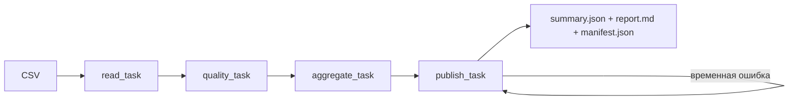

# Конспект: оркестрация, качество и повторы на Prefect

19.10.2026, версия 0.1.1. Основной новый инструмент — Prefect 3.8.8.
[Запуск и ожидаемые результаты](README.md), [контракт проекта](CONCEPT.md).
Это самостоятельная учебная работа на синтетических данных.

## 1. Задача простыми словами

Представим маленький магазин. Раз в день он получает файл заказов. Аналитику нужна
выручка по дням, но сначала надо проверить формат, убрать повторно присланные заказы
и исключить отменённые. Нельзя записывать сводку, если часть входа непонятна: такая
таблица выглядит достоверной, хотя сумма уже неверна. Ещё бывает временно недоступен
приёмник. Тогда полезно повторить запись, сохранив единый результат.

Проект показывает весь путь: CSV → контроль качества → дневные суммы → папка отчёта.
Вход O0001 содержит две книги по 15000 копеек. На выходе этот заказ добавляет 30000
копеек к 1 октября. Повтор той же строки ничего не добавляет, а отменённый заказ
на сумку не попадает в выручку. Это конкретные бизнес-правила, а не свойства Prefect.

## 2. Что изучаем

Оркестрация — управление порядком и состояниями шагов. Flow описывает запуск
конвейера целиком, task — наблюдаемый шаг. Future представляет ещё не готовый
результат. Когда future чтения передаётся в проверку, Prefect знает зависимость:
проверять можно только успешно прочитанные данные. Получается направленный граф
без циклов, в этом проекте обычная цепочка из четырёх вершин.

В Go-проекте основным вопросом была ограниченная память при чтении потока. Здесь
объём намеренно мал, зато изучаем границу между обработкой и управлением обработкой.
Чистые функции ничего не знают о Prefect, задачи вызывают эти функции, CLI связывает
настройки и аргументы. Благодаря этому основную математику можно проверить без сервера.

Для одноразового запуска хватило бы четырёх обычных функций. Prefect выбран, чтобы
потрогать зависимости, состояния и избирательный retry. Он приносит много зависимостей:
полный список зафиксирован в uv.lock. Это осознанная учебная цена, а не необходимость
для сложения нескольких чисел. uv восстанавливает окружение по lock-файлу;
`--frozen` запрещает незаметно пересчитать версии во время запуска.

## 3. Контракт данных

Единица строки — окончательное состояние одного заказа. `order_id` — буква O и четыре
цифры, `order_date` — календарная дата 2000–2099 годов, `product` — book, pen или bag.
`quantity` — положительное целое до 9999, `unit_price_cents` — положительное целое
до 9999999, `status` — paid или cancelled. В примере используются рубли и копейки,
но отдельного поля валюты нет. Часовой пояс не нужен, потому что время суток отсутствует.

Проверяем точный заголовок и порядок колонок. Не принимаем пустой пакет, лишние
столбцы, неизвестные товары, дробные цены, пробелы и знаки в числах. Проверка даты
проходит двумя ступенями: регулярное выражение проверяет запись, date.fromisoformat
проверяет календарь. Например, 2026-02-30 выглядит похоже на дату, но не существует.

ID с полностью совпадающей записью считается дублем. ID с другим количеством или
статусом — конфликт, который блокирует пакет. Автоматически выбирать «последнюю»
строку нельзя: контракт не содержит версии события или времени изменения.
CSV ограничен миллионом байт и десятью тысячами строк данных, включая дубли.
Исходные байты читаются с пределом плюс один: превышение замечается до полного
загрузки огромного файла. Это маленький пакетный обработчик, не потоковая система.

Генератор не использует случайность: шесть константных заказов и две точные копии
дают восемь строк. Он создаёт новый файл исключительно, поэтому повтор команды
не уничтожает предыдущий вход. LF задаётся явно, чтобы пример не зависел от ОС.
CRLF и UTF-8 BOM также принимаются, но меняют хэш исходных байтов.

## 4. Архитектура и состояние

Все четыре задачи отправляются через submit. Передача futures выражает порядок,
поэтому зависимые функции не выполняются над результатом упавшего шага. Два потока
ThreadPoolTaskRunner позволяют задачам ждать зависимости, но эта цепочка не становится
параллельным вычислением. Не стоит выдавать количество потоков за ускорение.

Вход, уникальные заказы и сводка находятся в памяти. Состояния запусков Prefect
хранятся в локальной SQLite внутри workspace. Результаты задач не сохраняются
через механизм persist_result, кэш Prefect отключён. При перезапуске чтение,
проверка и расчёт повторяются. Повторное использование готовой папки реализует
наш код, поэтому оно работает независимо от срока жизни кэша оркестратора.

`configure_local` вызывается до импорта Prefect, отделяет профиль и базу от настроек
пользователя и отключает аналитику. Контекст temporary_settings явно задаёт API URL
и API key равными None. При запуске создаётся временный сервер на loopback;
постоянная служба и облачный аккаунт не нужны. Техническая база остаётся в workspace,
сервер останавливается при завершении процесса. Эта папка не входит в публикацию.

## 5. Разбор ключевого кода и примеров

В `read_source` вычисляются два SHA-256: хэш исходного файла для проверки происхождения
и run_key от `sales-v1`, нулевого разделителя и входных байтов. Версия контракта входит
в ключ, чтобы изменение семантики не переиспользовало старую сводку. Если правила
расчёта изменятся, разработчик должен поднять эту версию. Хэш не заменяет подпись
или шифрование: он только связывает байты с результатом в данной модели.

В `quality_gate` словарь unique индексируется по order_id. Первая O0001 сохраняется,
вторая такая же запись увеличивает duplicates. После проверки остаются шесть
заказов. Функция `aggregate` сначала пропускает cancelled, затем группирует paid
по дате. Умножение quantity на unit_price_cents даёт сумму без ошибок float.
Дни сортируются, поэтому итоговый порядок воспроизводим.

Проследим три записи. O0001: 2 × 15000 = 30000. O0002: 3 × 2000 = 6000.
Вместе 1 октября получается 36000 копеек, два заказа и пять единиц товара.
O0003 отменён: он остаётся в unique_orders и cancelled_orders, но не в дневной
выручке. На 2 октября три оплаченных заказа дают 15000 + 100000 + 8000 = 123000.
Общий итог: пять оплаченных, один отменённый, два дубля, 159000 копеек.

`artifacts` формирует отсортированный JSON, русскую Markdown-таблицу и manifest.
Манифест содержит SHA-256 сводки и отчёта. Собственный хэш манифеста в него не входит,
иначе возникла бы циклическая зависимость. Для повторной публикации сравниваются
ожидаемые байты всех трёх файлов, поэтому редактирование самого манифеста тоже
будет замечено. Времена запусков и номера попыток намеренно не входят в эти файлы;
они выводятся отдельно в результате исполнения.

## 6. Сбои, повторы и восстановление

`retries=2` даёт до трёх попыток, включая первую. Но retry_condition_fn разрешает
повтор только для TransientPublishError. Флаг fail-once имитирует эту ошибку перед
изменением файлов на первой попытке записи. Номер попытки берётся из настоящего
TaskRunContext Prefect. При повторе шаг записывает результат и возвращает attempts=2.
Это контролируемый учебный отказ; он не распознаёт все реальные сетевые ошибки.

Неверная дата или конфликт ID не станут лучше через секунду, поэтому проверка
качества не повторяется. Обычная ошибка доступа к диску тоже не объявляется временной
автоматически. Повреждённая папка означает нарушение состояния, а не повод её стереть.
Smoke проверяет эту ветку за одну попытку через наблюдение retry_condition_fn.

При новом результате сначала создаётся соседняя .staging-папка. В неё записываются
три файла, затем она переименовывается в run_key. Обычное исключение очищает staging.
Граница видимости для обычного читателя — переименование папки в пределах одной
файловой системы. Это не гарантия сохранности при отключении питания: fsync нет.
Несколько одновременных писателей не поддерживаются. После принудительного завершения
может остаться staging, который удаляется вручную после остановки приложения.

Повтор того же файла сначала пересчитывает ожидаемый результат, затем сравнивает
готовую папку. Совпало — reused=true; не совпало — остановка без перезаписи. Даже
перестановка строк или замена LF на CRLF создаёт другой run_key при тех же суммах.
Это идемпотентность по байтам и версии контракта. Учёт изменений заказов между
разными файлами и глобальная дедупликация здесь отсутствуют.

## 7. Как проверять и чему верить

Команды находятся в README. Сначала выполняются 14 тестов обработки и файлового
поведения 2 теста CLI и настроек плюс 3 теста публикации. Затем smoke запускает настоящий временный Prefect:
успешная запись после отказа, одинаковый повтор, отказ качества, повреждённый результат.
Последний JSON должен содержать smoke=passed, retry_attempts=2, revenue_cents=159000.
Сообщения Failed в отрицательных случаях ожидаемы; общий код выхода остаётся нулевым.

Проверки границ нужны потому, что правдоподобная сумма недостаточна. Например,
одинаковые ID с разными значениями не должны тихо суммироваться, а сбой записи
не должен оставлять готовую папку с одним файлом. Manifest проверяется вычисленным
хэшем, повтор — сравнением всех байтов. Обещания о Windows и удалённом CI делаются
только после фактического запуска, статус записывается в VALIDATION.md.

## 8. Реальные ошибки разработки

Первый запуск упёрся в запрет локальных сокетов среды проверки. Это ограничение
песочницы, а не ошибка CSV: проверка выполнена с разрешением временного локального
сервера. Никакая постоянная служба не устанавливалась.

Затем обнаружился настоящий дефект настройки. API URL был задан пустой строкой.
Основной клиент трактовал её как отсутствие адреса и запускал временный сервер,
но EventsWorker проверял тип str и пытался использовать пустой адрес как готовый.
Получались сообщения о stopped service. Исправление: не подставлять пустую строку,
а явно задавать None через temporary_settings. После этого событийный клиент заработал.

Первая проверка числа попыток сразу читала task run через API и получила 404.
Состояния задачи передаются событиями, поэтому такая проверка зависела от времени
их обработки. Вместо ожиданий наугад тест наблюдает настоящий retry_condition_fn
и номер попытки, который передаёт движок. Так проверяется нужное поведение напрямую.

## 9. Ограничения и развитие

Нет расписания, workers на других компьютерах, очереди, обновлений заказов и
инкрементального хранилища. Набор целиком в памяти; предел в миллион байт — часть
контракта, а не измеренная производительность. Параллельные изменения файлов,
аварии ОС и аудит безопасности не проверялись. Для продакшена пришлось бы определить
версию события, ключ загрузки, транзакцию приёмника и политику очистки истории.
Следующий разумный шаг — запись в PostgreSQL с уникальным batch_id и транзакцией.

## 10. Собеседование и упражнения

Честное представление: «В учебном проекте связал четыре задачи Prefect, отделил
контракт от оркестрации и проверил поведение при повторах и плохом входе».

- Чем retry отличается от идемпотентности? Первый повторяет действие, вторая делает повтор безопасным для результата.
- Почему не повторять любую ошибку? Ошибка контракта требует исправления входа, а повтор только тратит время.
- Что обеспечивает порядок? Зависимости futures; не порядок печати сообщений из разных потоков.
- Почему деньги целые? Сложение и умножение копеек не вносят округление двоичного float.
- Достаточно ли одного хэша для exactly-once? Нет: нужны определённые границы системы, ключи и транзакционные гарантии приёмника.

1. Добавьте ещё одну точную O0002. Ожидается 9 строк, 3 дубля, прежняя выручка,
   другой run_key. Проверьте summary.json.
2. Измените O0001 только во второй копии. Ожидается конфликт и отсутствие нового
   результата. Исправьте файл и повторите запуск с тем же выходным корнем.
3. Замените оба появления O0005 на cancelled. Ожидается выручка 59000 копеек,
   4 оплаченных и 2 отменённых. Почему надо изменить обе копии?
4. Добавьте unit-тест для quantity=10000 и цены с ведущим нулём. Обе строки должны
   отклоняться до агрегирования; проверьте, что тест действительно падает без проверки.
5. Добавьте новую версию контракта sales-v2 без изменения формулы. Суммы останутся
   теми же, run_key изменится. Объясните, почему история Prefect не является ключом загрузки.

## 11. Источники

- [Prefect: workflows](https://docs.prefect.io/v3/how-to-guides/workflows/write-and-run) — flow, task и выполнение.
- [Prefect: retries](https://docs.prefect.io/v3/how-to-guides/workflows/retries) — retries, задержка и retry_condition_fn.
- [Prefect settings](https://docs.prefect.io/v3/api-ref/settings-ref) — локальные настройки и аналитика.
- [uv: lock и sync](https://docs.astral.sh/uv/concepts/projects/sync/) — воспроизводимость окружения.
- [Python CSV](https://docs.python.org/3.12/library/csv.html) — строгий разбор и newline.
- [Python pathlib](https://docs.python.org/3.12/library/pathlib.html) — файлы и переименование.

Связь хэша с версией контракта, состав публикации и политика ошибок — решения этого
проекта. Их гарантии ограничены описанным локальным сценарием.

Учебное дополнение 19.10.2026: русские комментарии находятся непосредственно
в core.py, orchestration.py, local.py, CLI, проверках и упаковке. Для навигации
служит [START_HERE](START_HERE.md), для аргументации — [DECISIONS](DECISIONS.md),
для самостоятельного изменения — [10 заданий](EXERCISES.md). Лабораторные preview
показывают промежуточные значения без сервера, а задачи VS Code вызывают те же
штатные команды. Версия приложения 0.1.1; смысл данных остаётся sales-v1.

21.10.2026: исходники опубликованы; CI 39501013966 выполнил 19 тестов и настоящий
локальный Prefect smoke на Ubuntu и Windows. Прежняя задержка публикации снята.
